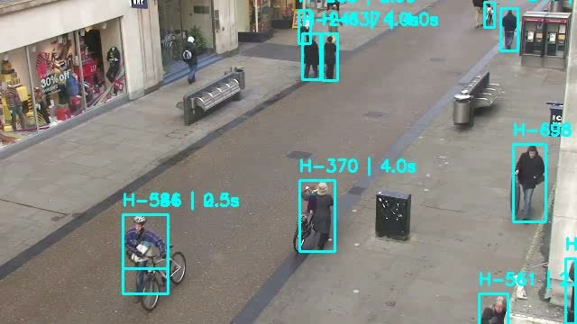

# People Detection, Tracking & Heatmap Visualization

Detects and tracks people in a video using **YOLOv11** and **SORT**, then visualizes
their movement with per-person paths and a foot-traffic **heatmap**, all inside a
**Streamlit** dashboard.



## Features

- **Detection:** YOLOv11 (Ultralytics) detects people frame by frame.
- **Tracking:** SORT assigns a stable ID to each person and measures how long they
  stay in view (dwell time).
- **Heatmap:** accumulates where people spend time to reveal foot-traffic density.
- **Path view:** draws the movement trail of any selected person ID.
- **Dashboard:** a Streamlit app plays the tracked video, heatmap, and path side by
  side, with speed controls and a frame slider.

## Pipeline

```
people.mp4  ──prepare_data.py──►  people_resized.mp4 + detections.csv
            ──tracking.py──────►  tracked_output.csv + tracked_output.mp4
            ──heatmap_generator──►  heatmap_video.mp4
            ──path_generator────►  path_video.mp4   (per selected ID)
app.py (Streamlit) ties it all together.
```

## Setup

Requires Python 3.9+.

```bash
pip install -r requirements.txt
```

A sample `people.mp4` and the pre-generated outputs are included, so you can run the
app right away. The YOLO weights (`yolo11n.pt`) are bundled too (and download
automatically if missing).

## Run

```bash
streamlit run app.py
```

Select a person ID in the UI to see their movement path and dwell time.

To rebuild from scratch (or use your own footage), replace `people.mp4`, delete the
generated files, and run:

```bash
python prepare_data.py   # resize + YOLO detection -> detections.csv
streamlit run app.py     # tracking + heatmap are regenerated on launch
```

## Credits

- **SORT** (`sort.py`) by Alex Bewley - <https://github.com/abewley/sort> - licensed under GPL-3.0.
- **YOLOv11** by Ultralytics - <https://github.com/ultralytics/ultralytics>.

## License

This project includes SORT, which is GPL-3.0, so this repository is released under
the **GNU General Public License v3.0**. See the `LICENSE` file.
